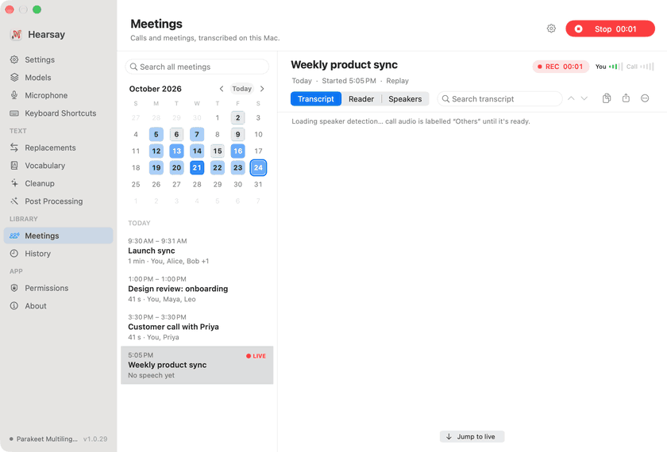
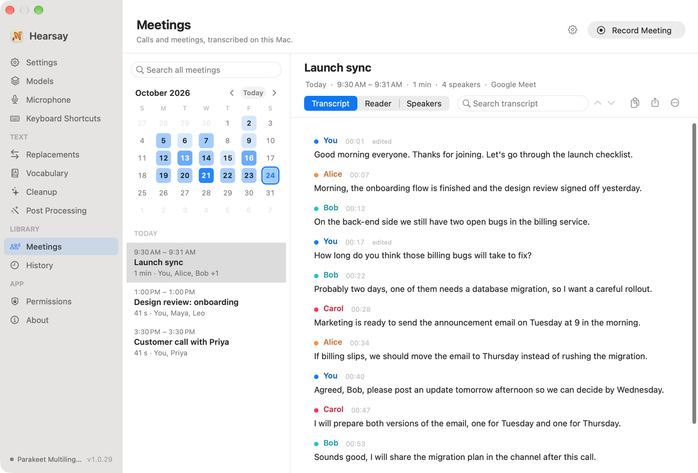
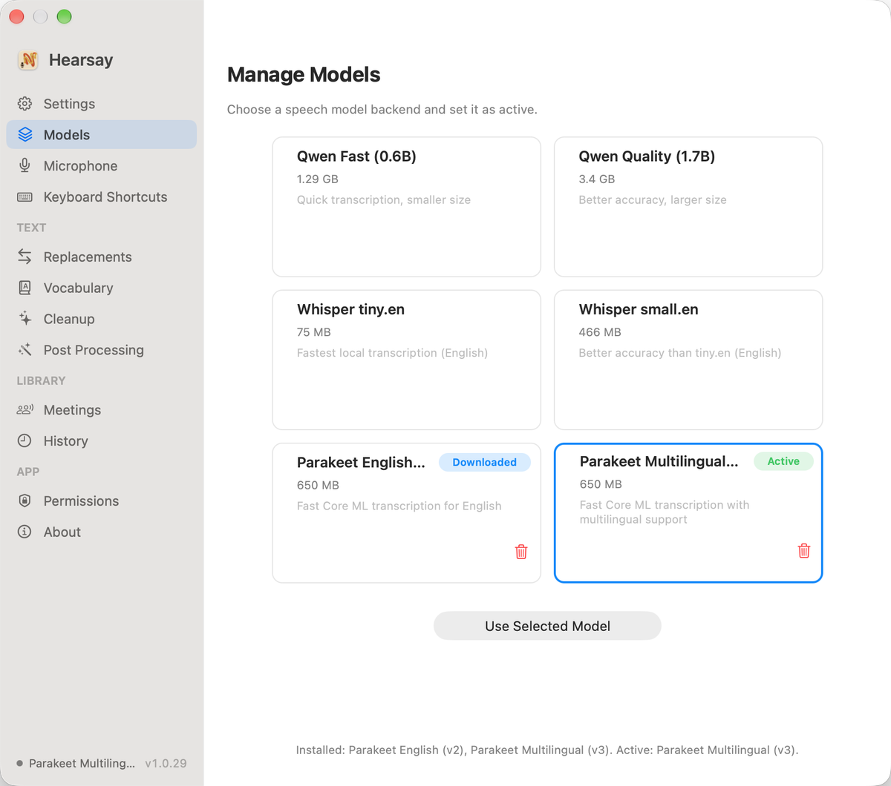
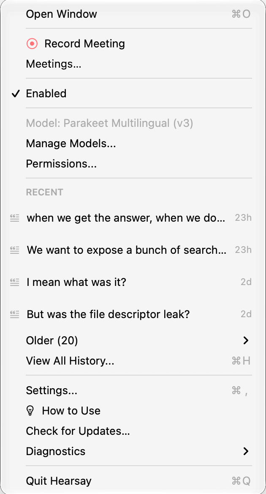
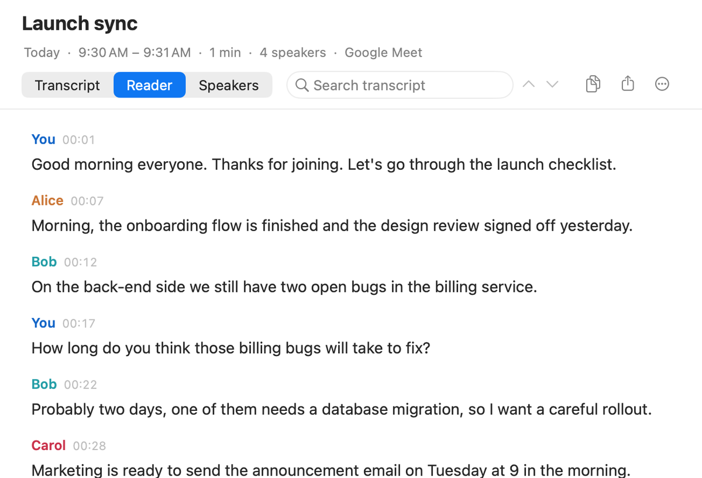
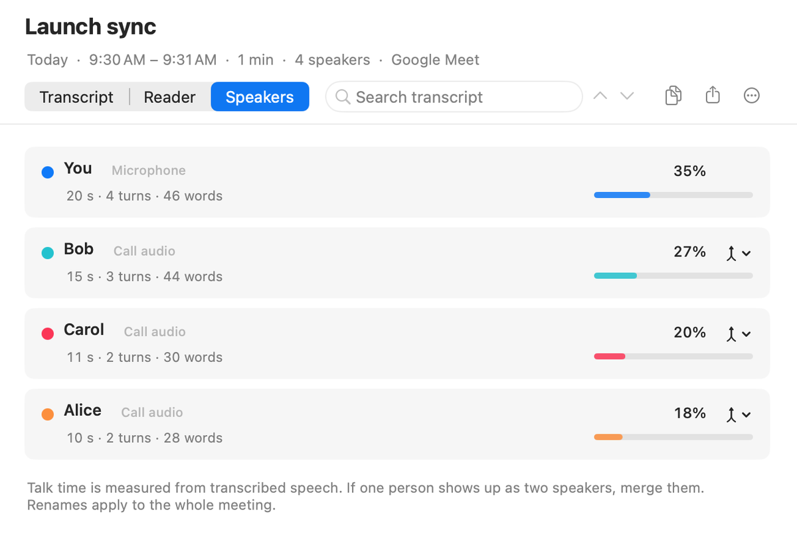
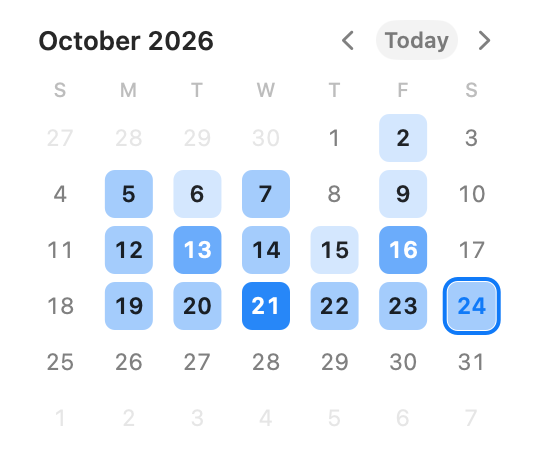
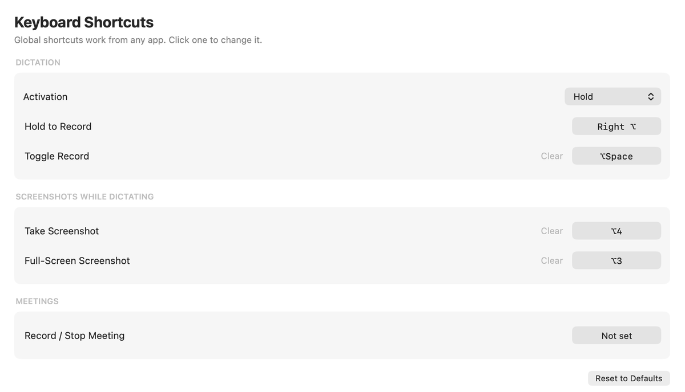

<p align="center">
  
</p>

<h1 align="center">Hearsay</h1>

<p align="center">
  <b>Talk instead of type, and keep a transcript of every meeting.</b><br/>
  Speech-to-text for macOS that runs entirely on your Mac.
</p>

<p align="center">
  <a href="https://github.com/swairshah/hearsay/releases/latest"><b>Download for macOS</b></a>
  &nbsp;·&nbsp;
  <code>brew install --cask swairshah/tap/hearsay</code>
  &nbsp;·&nbsp;
  <a href="https://hearsay.exe.xyz">hearsay.exe.xyz</a>
</p>

<p align="center">
  
</p>

<table>
  <tr>
    <td width="46.8%"></td>
    <td width="36.0%"></td>
    <td width="17.2%"></td>
  </tr>
</table>

## Dictate into any app

Hold **Right Option (⌥)**, say what you want to write, and let go. The text appears wherever your cursor is: an email, a chat, a code editor, a terminal.

<p align="center">
  
</p>

- **Hands-free:** press **⌥Space** to start and **Space** or **Esc** to stop, for longer thoughts.
- **Screenshots while you talk:** press **⌥4** to grab a region or **⌥3** for the whole screen, and the image is referenced in your text.
- **Nothing gets lost:** every transcription is kept in History. The last few are in the menu bar, one click to copy. If a transcription fails, the audio is kept so you can retry it.

## Transcribe your meetings

Click **Record Meeting** in the menu bar or the Meetings window, or set a shortcut for it. The menu bar icon turns red, and the transcript builds as people talk.

<p align="center">
  
</p>

Hearsay records your microphone and the call audio separately, so it knows which lines are yours. It works with Zoom, Google Meet, Teams, Slack, FaceTime, or anything else that plays sound on your Mac. Everyone on the call is told apart by voice. When you stop, Hearsay takes one more pass over the whole recording to sort out who said what, then tidies up filler words.

<table>
  <tr>
    <td width="50%" valign="top">
      
      <p><b>Know who said what.</b> Rename speakers once and every line updates. See how much each person talked, and merge two labels if one person got split in two.</p>
    </td>
    <td width="50%" valign="top">
      
      <p><b>Find any meeting.</b> The calendar is shaded by how busy each day was. Pick a day to see its meetings, or search every transcript at once.</p>
    </td>
  </tr>
</table>

- **Three ways to read:** a timeline you can edit, a clean reading view, and per-speaker stats.
- **Share it:** copy the transcript, or export it as Markdown.
- **Gentle reminders:** Hearsay can offer to record when a call starts, ask whether the meeting is over after a quiet stretch, and offer to stop when everyone says goodbye. It only stops by itself after a long silence, and you can turn that off.
- **No echo:** if you use speakers instead of headphones, your mic hears the call too. Hearsay drops those duplicate lines.

## Make it yours

<p align="center">
  
</p>

- **Shortcuts:** change any of them in **Keyboard Shortcuts**, including a shortcut to start and stop meeting recording.
- **Vocabulary:** teach Hearsay the names and jargon it keeps getting wrong ("human lair" → HumanLayer), and it fixes them in dictation and meetings.
- **Replacements and Cleanup:** swap phrases for others and drop filler words automatically.
- **Speech models:** choose between Parakeet (recommended on Apple Silicon), Qwen (works on Intel too) and Whisper. Download, switch and delete them from **Models**.

## Private by design

Your voice never leaves your Mac. Transcription, speaker detection and clean-up all run on-device, with no account, no cloud service and no subscription. Meeting transcripts are plain files in `~/Library/Application Support/Hearsay/Meetings`, and you can cap how much space their audio uses.

## Getting started

1. **Install** from the [latest release](https://github.com/swairshah/hearsay/releases/latest) (open the DMG and drag Hearsay to Applications), or with Homebrew:
   ```bash
   brew install --cask swairshah/tap/hearsay
   ```
2. **Allow the Microphone and Accessibility** when asked. Accessibility lets Hearsay listen for its shortcut and paste text at your cursor.
3. **Pick a speech model** to download. Parakeet is the best choice on Apple Silicon.
4. **For meetings,** allow *System Audio Recording* the first time you record, so Hearsay can hear the call.

**Requirements:** macOS 13 or later on Apple Silicon or Intel. Recording call audio needs macOS 14.2 or later, and telling speakers apart needs Apple Silicon.

## For you and your agents

Hearsay comes with a `hearsay` command, so you (or an AI agent) can work with your meetings from the terminal:

```bash
hearsay meeting start              # or stop, status
hearsay meetings show latest       # the last meeting as Markdown
hearsay meetings search "pricing"  # across every meeting
hearsay vocab add HumanLayer --alias "human lair"
```

Apps and editor plugins can also use Hearsay for dictation through its [local API](docs/local-api-integration-guide.md).

## For developers

- Build instructions and architecture: [DEVELOPMENT.md](DEVELOPMENT.md)
- Speech models: NVIDIA Parakeet via [FluidAudio](https://github.com/FluidInference/FluidAudio), [qwen-asr](https://github.com/antirez/qwen-asr) by antirez, and [WhisperKit](https://github.com/argmaxinc/WhisperKit). Speaker detection uses FluidAudio's on-device diarization models.

## License

MIT
